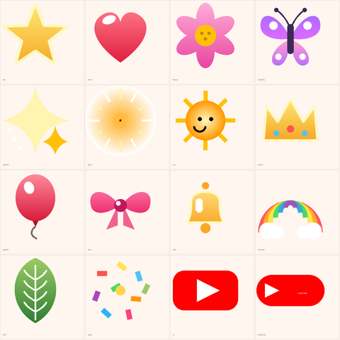

# Simple Video Maker 🎬

A **fully native** Android video editor, kept simple enough for a grandmother — with the
tools everyone actually wants: **drafts, a real timeline, split, speed, transitions, filters,
music, per-clip audio, stickers and text with glow**. It runs **landscape 16:9**, like a normal
editing app, and every movie is rendered in the same 16:9 frame by default.

> No WebView. No ffmpeg. No internet, no account. Everything is rendered and encoded on the phone
> with `MediaCodec` → `Canvas` → `MediaCodec` (H.264) → `MediaMuxer`.

The APK is built by **GitHub Actions** on every change.

---

## Install

1. **[Releases](../../releases) → `apk-latest` → `SimpleVideoMaker-1.2.apk`**
   (also committed at `public/SimpleVideoMaker-1.2.apk`, and in *Actions → latest run → Artifacts*).
2. Send the file to the phone (WhatsApp / Drive / USB), tap it, allow *"Install unknown apps"*.
3. Open **Simple Video Maker** from the app drawer — hold the phone sideways (the app is
   **landscape only**). Works offline, forever.

Movies are saved to **Gallery → Movies → SimpleVideoMaker**; the result screen offers
**Watch** and **Share** (WhatsApp, etc.).

---

## What's inside

### 📁 Projects / Drafts
* Home screen lists every video as a draft card with its thumbnail, clip count and length.
* Everything auto-saves as you edit — close the app, come back later, keep going.
* **Rename**, **Duplicate**, **Delete** (long-press a draft) — photos always stay safe in the gallery.
* Media access is remembered (`ACTION_OPEN_DOCUMENT` + persistable URIs), so drafts survive reboots.

### 🎞️ The timeline (real one)
* A **scrubber bar with a time ruler** (0:00 · 0:05 · 0:10 …) under the preview.
* Every clip is a **block with its own filmstrip** — drag the orange **playhead** anywhere to jump,
  **pinch with two fingers** to zoom 1×–10×, tap a block to select that clip.
* A thin **audio lane** under the blocks shows the music and a ♪ / 🔇 badge per clip.
* The preview follows the playhead frame by frame (the real decoded video frame, not a thumbnail).

### ✂️ The editor
| Tool | What it does |
|---|---|
| 🔤 **Text** | any words + ready phrases ("Subscribe to my YouTube ❤️", "नमस्ते 🙏"…), **6 fonts** (Bold, Serif, Handwriting, Mono, Narrow, Thin), 5 colours, **glow** |
| 😊 **Sticker** | **16 real vector stickers** — ⭐ star, ❤️ heart, 🌸 flower, 🦋 butterfly, ✨ sparkle, 🔆 glow, ☀️ sun, 👑 crown, 🎈 balloon, 🎀 bow, 🔔 bell, 🌈 rainbow, 🍃 leaf, 🎉 party, plus **YouTube / SUBSCRIBE** buttons — and 6 text badges (`LIKE & SHARE`, `FOLLOW ME`, `THANK YOU`, `BELL`, `MY VLOG`) and 30 emoji |
| 🔊 **Sound** | one panel for all audio: **background music** (pick a song, volume slider, remove), **clip sound ON/OFF**, and a **volume slider for the selected clip** |
| ✨ **Effect** | transitions between clips: **Fade, Slide, Zoom, Circle** |
| 🎨 **Look** | colour filters: **Warm, Cool, Black & White, Vivid, Sepia** |
| ⏱️ **Duration** | how long a photo stays (2s / 3s / 5s / 8s) |
| ⏩ **Speed** | video 0.5× (slow), 1×, 1.5×, 2× (fast) |
| ✂️ **Split** | cuts the selected clip **exactly at the playhead** (or in the middle if the playhead is at an edge), then each half can be reordered or restyled |
| ⬅️ ➡️ | move the clip earlier / later · 🔀 **Copy** duplicates it · 🗑️ **Remove** deletes it |
| 👆 drag | move any text/sticker with a finger |
| 🔍 **size** | a slider plus two-finger pinch: stickers and text go from tiny to screen-filling (2 % → 95 % of the frame) |
| 📐 **Size** | output resolution: **1920×1080 landscape HD (default)**, **1080×1920 Full HD**, **1080×1080 square**, **720×1280 HD**, **540×960 small** + quality 2.5 / 5 / 8 / **12 Mbps** (default 8) |
| ▶️ **Preview** | watch the real composition (filters, text, transitions) before saving |
| 🎉 **Make Video** | renders a real **MP4 1920×1080, 30 fps** into the Gallery |
| हिं / EN | the entire app switches between **Hindi and English** |
| ❓ | a help sheet written for a first-time smartphone user |

The soundtrack is built by mixing the phone's music with the clips' original sound and
re-encoding it to AAC (44.1 kHz stereo) — see `AudioMixer.java`.

### Stickers are drawn, not typed



Every sticker in `StickerArt.java` is a hand-made path + gradient drawing, so it stays sharp
at any size (a 30 px picker chip and a 900 px sticker in a 1080p movie use the same code),
takes no memory, and works with no internet and no bundled image files.

---

## How it works

```
photos ─┐
        ├─→ FrameRenderer (Canvas): fit/crop, ken-burns zoom, filter, text, stickers, transitions
videos ─┘        │
                 ├─→ preview: frames shown on screen in real time (PreviewPlayer path)
                 └─→ export: MediaCodec H.264 encoder (COLOR_FormatYUV420Flexible input images)
                              + AudioMixer (AAC) / passthrough  →  MediaMuxer  →  MP4  →  Gallery
```

* `VideoExporter.renderFrames()` draws the movie frame by frame; the same code powers the preview
  and the export, so what she sees is what she gets.
* Video clips are decoded with `MediaCodec` to `Image` (YUV) → ARGB bitmaps, with rotation handled.
* Everything streams — a 5-minute movie never loads minutes of audio or video into RAM.

## Project layout

```
android/app/src/main/java/com/simplevideomaker/app/
    MainActivity.java    native UI: drafts, landscape editor, dialogs (text/sticker/sound/effects), export
    TimelineView.java    the scrubber: ruler, filmstrip blocks, playhead drag, pinch zoom, audio lane
    Scrubber.java        turns the playhead into a real decoded frame for the preview
    EditorView.java      live preview, drag text/stickers with a finger
    FrameRenderer.java   draws one 720x1280 frame: media, filters, text, stickers, transitions
    VideoExporter.java   decode → composite → H.264 encode → mux (also powers the preview)
    AudioMixer.java      music + clip sound → mix → AAC (streaming, looped music)
    MediaSaver.java      save into Gallery, Share / Watch intents
    StickerArt.java      the 16 vector stickers (paths + gradients, scalable)
    StickerChip.java     sticker preview in the picker
    Project.java  ProjectStore.java  Clip.java  Overlay.java
tools/make_icons.py      regenerates every launcher icon (pure Python, no deps)
.github/workflows/android.yml   the APK build (JDK 17 + Android SDK 34 + gradle)
```

## Building

* **Cloud:** Actions → *Build Android APK* → *Run workflow* (or just push to the branch).
  Produces the `SimpleVideoMaker-apk` artifact, a `signing-keystore`, a release, and refreshes
  `public/SimpleVideoMaker-1.2.apk`.
* **Local:** Android Studio (open `android/`), or:

```bash
cd android
gradle assembleRelease     # APK -> android/app/build/outputs/apk/release/
```

Requirements: `minSdk 24` (Android 7), `targetSdk 34`, landscape only, no third-party libraries.

## Known trade-offs

* The app is **landscape only** and the default export is **1920×1080 (16:9)**; portrait 9:16 for
  status/Shorts is one tap away in **📐 Size**.
* A clip longer than 60 s is trimmed to its first minute; whole movies are capped at 5 minutes.
* **Sound** → *Clip sound is OFF* keeps the music only, exactly like muting the original audio.
* Sped-up clips keep the music only when their sound would go out of sync.
* Effects apply from the second clip onwards.

> The old `3D-Game` scaffold was empty (a one-line README, no code), so it was replaced by this app.
